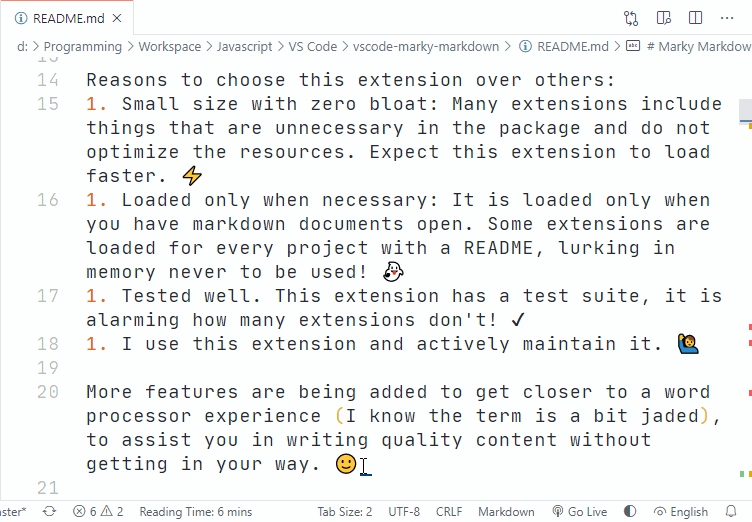

<h1 align="center">
   
    
   
	 
  Marky Stats
   
   
</h1>
<h4 align="center">Configurable statistics about your markdown document on your status bar</h4>
 

The stats appear as an item on the left-hand side of the status bar.

You can change the stats shown by clicking the item, or running the command.

## Commands

This command can be run from the Command Palette (`Ctrl+Shift+P`):

- `Marky Stats: Change Statistic`

## Activation

The extension is only loaded when a markdown file is open. To be more specific, the [activation event](https://code.visualstudio.com/api/references/activation-events) is `onLanguage: markdown`.

## Settings

| Name | Type | Default | Description |
| -------------------------------------------------- | ------- | ------- | ------------------------------------------------------ |
| Marky Markdown: Stats Show Reading Time | Boolean | true | Show "Reading Time" on the status bar. |
| Marky Markdown: Stats Show Words | Boolean | false | Show "Words" counter on the status bar. |
| Marky Markdown: Stats Show Lines | Boolean | false | Show "Lines" counter on the status bar. |
| Marky Markdown: Stats Show Characters | Boolean | false | Show "Characters" counter on the status bar. |
| Marky Markdown: Stats Item Separator | String | 2 spaces | Separator between items on status bar. |
| Marky Markdown: Stats Words Per Minute | Integer | 250 | Set the words per minute that is used to calculate "Reading Time". |
| Marky Markdown: Stats Alignment | String (enum) | "Left" | Set the position on the status bar. Values are : "Left" and "Right". |

## Contributions

If there is a bug, please raise an issue.

I consider this extension feature complete. You are welcome to raise an issue and make a suggestion, but I am unlikely to implement more features.

## Appreciate

You can show your appreciation by:
1. [Buying me a coffee or sponsoring me](https://ko-fi.com/roboleary)
1. Leaving a positive review in the [visual studio marketplace](<https://marketplace.visualstudio.com/items?itemName=robole.marky-stats&ssr=false#review-details>).
1. Starring the repo 🌟.

This will **help other people find the extension**.

It will **offer me encouragement** to continue, and can provide **a path to dedicating more time to open-source** in the future.

Thank you! 🙏

## FAQ

### Why isn't Marky Stats appearing in the Status Bar?

On a crowded status bar, the Marky Stats may have been forced out! You can test this by zooming out, so the text becomes very small, and you will see more items on the status bar.

Go to the User Settings, and hide or disable other status bar items to make space.
